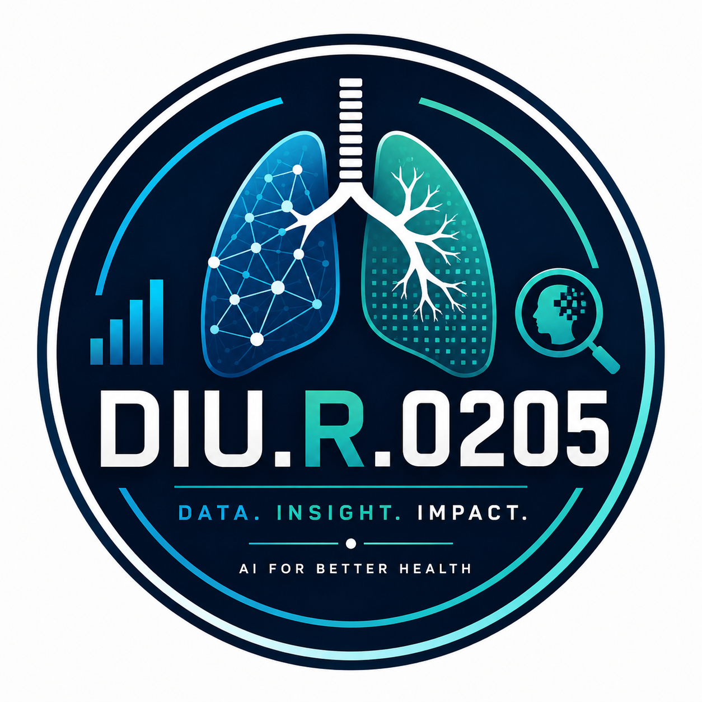
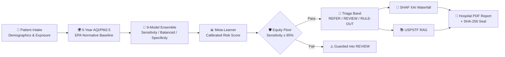

<!-- ============ HERO SECTION ============ -->
<div align="center">



# 🫁 LungCancer.NET

### Accessible AI Clinical Pre-Screening & Risk Stratification Portal

**Detecting lung cancer risk *before* the CT scan — in communities that need it most.**

[](https://example.com)
[](https://python.org)
[](https://streamlit.io)
[](DESIGN.md)
[](docs/security.md)

<br/>

**[🚀 Quickstart](#-quickstart)** &nbsp;·&nbsp;
**[🔑 User Provisioning & Auth](#-user-provisioning--cryptographic-auth)** &nbsp;·&nbsp;
**[🎨 Accessible UI/UX Design](#-accessible-uiux-design-for-older-adults)** &nbsp;·&nbsp;
**[🛡️ Security Audit](#-security-audit--data-handling)** &nbsp;·&nbsp;
**[⚡ Fast Personas](#-fast-evaluation-personas)** &nbsp;·&nbsp;
**[🔌 MCP Server](#-model-context-protocol-mcp-server)**

</div>

---

## 💡 Why LungCancer.NET?

> **Lung cancer is the leading cause of cancer death worldwide** (1.8M deaths/year).
> Yet **~70% of rural and underserved patients** never receive LDCT screening — not because
> they're low-risk, but because **the CT scanner is 3 hours away.**

**LungCancer.NET flips the funnel:** instead of scanning everyone (impossible) or no one (unethical), we **stratify risk from non-invasive clinical & survey data** — then fast-track only high-risk patients for expensive imaging.

---

## 🎨 Accessible UI/UX Design for Older Adults

LungCancer.NET has been redesigned from the ground up for healthcare providers and patients aged 45–80. See full design tokens and contrast metrics in [`DESIGN.md`](DESIGN.md).

- **High-Legibility Typography**: Base body copy is locked to $\ge 18\text{ px}$. Primary triage values and risk estimates scale to $32\text{--}38\text{ px}$.
- **WCAG 2.1 AA High Contrast**: Strict compliance with contrast ratios: minimum 4.5:1 for body copy (up to 14.1:1) and 3:1 for all interactive boundaries.
- **Accessible Touch & Hit Targets**: All primary buttons, stepper tabs, and input controls feature $\ge 48 \times 48\text{ px}$ clickable hit areas with $\ge 12\text{ px}$ spacing.
- **Empathetic & Hopeful Palette**: Replaces sterile hospital grays with comforting deep marine (`#0B2545`), healing cyan (`#0284C7`), and gentle warm slates (`#F8FAFC`).
- **Color-Blind Accessible Multi-Modal Triage**: No clinical result is ever communicated by color alone. Every risk tier couples color with an icon and plain-text description:
  - 🚩 **REFER** — Terracotta badge + Flag icon + Immediate LDCT evaluation notice.
  - 🔍 **REVIEW** — Warm amber badge + Magnifier icon + Shared clinical decision-making.
  - 🛡️ **RULE-OUT** — Sage green badge + Shield icon + Routine annual surveillance.
- **Linear 4-Step Progressive Intake**: Lowers cognitive load by organizing clinical data into 4 clearly numbered steps: Demographics, Inhalation History, Comorbidities, and Access Safeguards.

---

## 🔑 User Provisioning & Cryptographic Auth

LungCancer.NET enforces zero-hardcoded credential security. No default passwords or sample credentials are baked into the source code, database, or UI.

### Step 1: Provision Your Initial Account
You can create your account either via the CLI tool or directly on the dashboard's "Create Account" tab:

```bash
# Provision a Clinician account (Full Access: intake, predictions, PDF)
python create_user.py --username drsmith --name "Dr. Sarah Smith, MD" --role clinician

# Or provision an Auditor account (Read-Only: inspect model predictions & reports)
python create_user.py --username auditor_alex --name "Alex Mercer" --role auditor
```

*Note: If `--password` is omitted from the command line, `create_user.py` will prompt for a password securely without echoing it to the terminal.*

### Cryptographic Security Specs
- **Storage**: Local SQLite database stored in `artifacts/users.db` (never committed to git).
- **Key Derivation Function**: **PBKDF2-HMAC-SHA256** with **250,000 iterations** and a 32-byte cryptographically secure random salt (`os.urandom(32)`).
- **Timing Attack Mitigation**: Verifies passwords using constant-time `hmac.compare_digest`.
- **Brute-Force Rate Limiting**: 5 consecutive failed login attempts automatically trigger a 60-second cooldown window.
- **Schema Template**: An empty schema template is provided in [`users.example.json`](users.example.json).

---

## 🏗️ Architecture



---

## 🛡️ Security Audit & Data Handling

A comprehensive security audit has been performed on the entire codebase:

### 1. Input Validation & Injection Prevention
- **Patient Identifiers**: Regex sanitized (`^[A-Za-z0-9_-]{1,24}$`). All HTML tags, script tags, SQL injection characters, and directory traversal tokens are stripped.
- **Biometric & Clinical Ranges**: All numeric inputs are clamped to strict physiological bounds:
  - Age: $[18, 100]$ years
  - BMI: $[10.0, 90.0]$ kg/m²
  - Pack-Years: $[0.0, 250.0]$ pack-years
  - 5-Year AQI / PM2.5: $[0.0, 500.0]$
- **State Whitelist**: Validated against all 50 US States.
- **RAG Queries**: Sanitized with length caps (max 300 characters) and bounded search depth ($k \in [1, 10]$).

### 2. Ephemeral In-Memory Data Handling (Zero Disk Writes)
- **Zero Patient Data on Disk**: Patient biometric information is **never** written to local disk, temp files, or logs.
- **In-Memory PDF Generation**: PDF reports are synthesized in RAM via `io.BytesIO()` and streamed directly to the browser download button.
- **Zero PII in Logs**: The tamper-evident session audit log records only one-way cryptographic SHA-256 hashes of patient references (`hashlib.sha256(pid.encode()).hexdigest()[:8]`), never patient identifiers or private health information.
- **Zero-Retention Mode**: When logging out or resetting, all in-memory clinical state in `st.session_state` is purged.

---

## 🔌 Model Context Protocol (MCP) Server

[`mcp_server.py`](mcp_server.py) provides a secure interface for AI agents using the official MCP Python SDK v2.x.

### Security & Permission Policy
- **Minimum Necessary Permissions**: Exclusively exposes **read-only** analytical tools.
- **Zero Write Operations**: Contains no tools capable of modifying files, altering databases, or persisting inputs.
- **Zero Shell Execution**: No subprocess execution, no shell spawning, no `os.system`, no `eval`/`exec`.
- **Strict Parameter Clamping**: Clamps all incoming tool arguments to safe clinical ranges.

### Available MCP Tools
1. `predict_lung_cancer_risk`: Read-only execution of the 9-predictor ensemble, risk score, confidence interval, and SHAP attribution.
2. `search_uspstf_guidelines`: Read-only semantic search of the local USPSTF guideline vector database.
3. `get_clinical_summary`: Read-only generation of a structured clinical assessment statement.

```bash
# Run via standard I/O (MCP Inspector / Client)
python mcp_server.py

# Run via Streamable HTTP
python mcp_server.py --http --port 8000
```

---

## ⚡ Fast-Evaluation Personas

For judges and congress evaluators, the dashboard features **1-Click Quick-Load Personas**:

| Persona | Clinical Profile | Expected Triage Tier | Clinical Action |
|---|---|---|---|
| 🔴 **High-Risk Smoker** | 66yo, 32 yr smoking, COPD, Ohio, high PM2.5 | **REFER** | Immediate Low-Dose CT (LDCT) Order |
| 🟢 **Low-Risk Patient** | 29yo, non-smoker, healthy, Maine, clean air | **RULE-OUT** | Safe for routine annual community health check |
| 🟡 **Borderline Review** | 53yo, 14 pk-yr, Asthma, California | **REVIEW** | Shared clinical decision-making & monitoring |
| 🛡️ **Equity Safeguard** | 58yo, 22 pk-yr, rural/cost barrier | **REFER / REVIEW** | Equity floor overrides clearance to protect patient |

---

## 🚀 Quickstart

### 1. Environment Setup
```bash
# Clone the repository
git clone https://github.com/your-username/LungCancer.NET.git
cd LungCancer.NET

# Install dependencies
pip install -r requirements.txt
```

### 2. Create Your First Account
```bash
python create_user.py --role clinician
```

### 3. Launch the Application
```bash
streamlit run app.py
```
Open your browser to `http://localhost:8501`.

---

## 📁 Repository Structure

```
LungCancer.NET/
├── app.py                     # Accessible Streamlit clinical dashboard (WCAG 2.1 AA)
├── auth.py                    # PBKDF2-HMAC-SHA256 authentication & RBAC engine
├── create_user.py             # User provisioning CLI tool
├── users.example.json         # Empty schema template for users
├── DESIGN.md                  # Comprehensive design system, typography, & contrast specs
├── CHANGELOG.md               # Detailed log of UI/UX and architectural changes
├── predictor.py               # Calibrated ensemble inference & SHAP engine
├── report_generator.py        # Hospital-grade PDF report builder (in-memory)
├── mcp_server.py              # Secured, read-only MCP server (3 tools)
├── rag.py                     # Offline semantic USPSTF guideline search (ChromaDB)
├── aqi_cache.py               # 5-Year historical AQI & PM2.5 utility
├── artifacts/
│   ├── users.db               # Local SQLite user store (git-ignored)
│   ├── aqi_5yr_cache.json     # 50-state historical AQI/PM2.5 cache
│   ├── policy.json            # Calibrated clinical triage thresholds (t_out, t_in)
│   ├── shap_reference.json    # Normative population SHAP feature weights
│   └── chroma/                # Local vector store with indexed USPSTF guidelines
├── assets/                    # Platform logos & watermarks
├── requirements.txt           # Python package dependencies
└── README.md                  # Documentation & quickstart guide
```

---

## ⚖️ Clinical & Ethical Disclaimer

LungCancer.NET is an investigational clinical decision-support tool designed for population-level pre-screening and triage prioritization. It computes statistical risk based on validated epidemiological cohorts (CDC BRFSS) and does not replace diagnostic imaging (LDCT), tissue histopathology, or direct evaluation by a licensed physician. All patient data is ephemeral and never written to disk.
