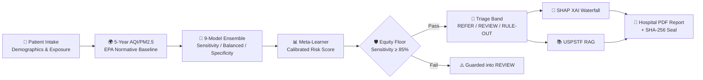

<!-- ============ HERO SECTION ============ -->
<div align="center">


# 🫁 LungCancer.NET

### Composite AI Clinical Pre-Screening & Risk Stratification System

**Detecting lung cancer risk *before* the CT scan — in communities that need it most.**

[](https://example.com)
[](https://python.org)
[](https://streamlit.io)
[](LICENSE)
[](docs/security.md)

<br/>

**[🚀 Live Demo](#-quickstart)** &nbsp;·&nbsp;
**[🔑 Authentication & Roles](#-authentication--role-based-access-control)** &nbsp;·&nbsp;
**[🛡️ Security Audit](#-security-audit--data-handling)** &nbsp;·&nbsp;
**[⚡ Fast Personas](#-fast-evaluation-personas)** &nbsp;·&nbsp;
**[🔌 MCP Server](#-model-context-protocol-mcp-server)**

</div>

---

## 💡 Why LungCancer.NET?

> **Lung cancer is the leading cause of cancer death worldwide** (1.8M deaths/year).
> Yet **~70% of rural and underserved patients** never receive LDCT screening — not because
> they're low-risk, but because **the CT scanner is 3 hours away.**

**LungCancer.NET flips the funnel:** instead of scanning everyone (impossible) or no one (unethical), we **stratify risk from non-invasive clinical & survey data** — then fast-track only high-risk patients for expensive imaging.

---

## ✨ Core Innovations

<table>
<tr>
<td width="50%" valign="top">

### 🎯 9-Predictor Ensemble Ladder
Three calibrated gradient-boosted operational regimes:
- **High Sensitivity** (weight 10) → rule-in capture
- **Balanced Optimization** (weight 5) → $F_\beta$ calibration
- **High Specificity** (weight 1) → rule-out protection

</td>
<td width="50%" valign="top">

### ⚖️ Equity-Aware Sensitivity Floor
`RULE-OUT` is **never issued** unless sensitivity ≥ **85%** across *every* demographic & socioeconomic subgroup. Model disagreement or uncertainty shifts patients to the `REVIEW` band.

</td>
</tr>
<tr>
<td width="50%" valign="top">

### 💰 Access-Aware Cost Function
The missed-referral penalty is weighted **1.5×** for rural or financially-barriered patients — prioritizing timely clinical navigation.

</td>
<td width="50%" valign="top">

### 🧠 Patient-Specific XAI
Real-time **SHAP waterfall attributions** decompose individual patient determinants (Pack-Years, Age, 5-Year PM2.5, COPD, Comorbidities).

</td>
</tr>
<tr>
<td width="50%" valign="top">

### 📚 Local Semantic RAG
**USPSTF** clinical screening guidelines indexed in local ChromaDB with sentence embeddings — on-device retrieval, zero external API leakage.

</td>
<td width="50%" valign="top">

### 📄 Hospital-Grade PDF Reports
Multi-page clinical reports with patient tables, XAI breakdowns, physician orders checklist, signature blocks, and a tamper-evident **SHA-256** integrity seal.

</td>
</tr>
</table>

---

## 🏗️ Architecture



---

## 🔑 Authentication & Role-Based Access Control

LungCancer.NET includes a cryptographic authentication gate using salted **bcrypt** password hashing:

### Pre-Configured Test Accounts (AI Builders Congress)

| Role | Username | Password | Access Level & Permissions |
|---|---|---|---|
| 👨‍⚕️ **Clinician** | `clinician` | `ClinicianPass2026!` | **Full Access:** Patient intake modification, persona loading, risk execution, XAI breakdown, and PDF report generation. |
| 🛡️ **Auditor** | `auditor` | `AuditorPass2026!` | **Read-Only Access:** Quality assurance audit mode. Intake fields and execution buttons are locked. Full access to inspect model outputs, SHAP waterfalls, guidelines, audit logs, and reports. |

### Registering New Users
Users can self-register directly through the **"📝 Register User"** tab on the authentication screen. Passwords must be at least 8 characters long and are hashed with 12 rounds of bcrypt before being stored in the session store.

---

## 🛡️ Security Audit & Data Handling

A comprehensive security audit has been performed on the entire codebase:

### 1. Input Validation & Injection Prevention
- **Patient Identifiers**: Regex sanitized (`^[A-Za-z0-9_-]{1,30}$`). All HTML tags, script tags, SQL injection characters, and directory traversal tokens are stripped.
- **Biometric & Clinical Ranges**: All numeric inputs are clamped to strict physiological bounds:
  - Age: $[18, 100]$ years
  - BMI: $[10.0, 90.0]$ kg/m²
  - Pack-Years: $[0.0, 250.0]$ pack-years
  - 5-Year AQI / PM2.5: $[0.0, 500.0]$
- **State Validation**: Validated against a strict whitelist of 50 US States.
- **RAG Queries**: Sanitized with length caps (max 300 characters) and bounded search depth ($k \in [1, 10]$).

### 2. Ephemeral In-Memory Data Handling (Zero Disk Writes)
- **Zero Patient Data on Disk**: Patient data is **never** written to local disk, temp files, databases, or logs.
- **In-Memory PDF Generation**: PDF reports are synthesized in RAM via `io.BytesIO()` and streamed directly to the browser download button.
- **Zero PII in Logs**: The tamper-evident session audit log records only one-way cryptographic SHA-256 hashes of patient references (`hashlib.sha256(pid.encode()).hexdigest()[:8]`), never patient identifiers or private health information.
- **Zero-Retention Mode**: When logging out or resetting, all in-memory clinical state in `st.session_state` is purged.

### 3. Protected External Integrations
- **Local Ollama Integration**: Operates locally on `http://localhost:11434`. Prompts contain only de-identified, non-identifying aggregate biomarker numbers (Age, Pack-Years, Comorbidity flags).
- **Deterministic Offline Fallback**: If Ollama or Docker is not running, the platform seamlessly falls back to a deterministic clinical pulmonology synthesis engine without making any network calls.

---

## 🔌 Model Context Protocol (MCP) Server

[`mcp_server.py`](mcp_server.py) provides a secure interface for AI agents using the official MCP Python SDK v2.x.

### Security & Permission Policy
- **Minimum Necessary Permissions**: Exclusively exposes **read-only** analytical tools.
- **Zero Write Operations**: Contains no tools capable of modifying files, altering databases, or persisting inputs.
- **Zero Shell Execution**: No subprocess execution, no shell spawning, no `os.system`, no `eval`/`exec`.
- **Strict Parameter Clamping**: Clamps all incoming tool arguments to safe clinical ranges.

### Available MCP Tools
1. `predict_lung_cancer_risk`: Read-only execution of the 9-predictor ensemble, risk score, confidence interval, and SHAP attribution.
2. `search_uspstf_guidelines`: Read-only semantic search of the local USPSTF guideline vector database.
3. `get_clinical_summary`: Read-only generation of a structured clinical assessment statement.

```bash
# Run via standard I/O (MCP Inspector / Client)
python mcp_server.py

# Run via Streamable HTTP
python mcp_server.py --http --port 8000
```

---

## ⚡ Fast-Evaluation Personas

For judges and congress evaluators, the dashboard features **1-Click Quick-Load Personas**:

| Persona | Clinical Profile | Expected Triage Tier | Clinical Action |
|---|---|---|---|
| 🔴 **High-Risk Smoker** | 66yo, 32 yr smoking, COPD, Ohio, high PM2.5 | **REFER** | Immediate Low-Dose CT (LDCT) Order |
| 🟢 **Low-Risk Patient** | 29yo, non-smoker, healthy, Maine, clean air | **RULE-OUT** | Safe for routine annual community health check |
| 🟡 **Borderline Review** | 53yo, 14 pk-yr, Asthma, California | **REVIEW** | Shared clinical decision-making & monitoring |
| 🛡️ **Equity Safeguard** | 58yo, 22 pk-yr, rural/cost barrier | **REFER / REVIEW** | Equity floor overrides clearance to protect patient |

---

## 🚀 Quickstart

### 1. Environment Setup
```bash
# Clone the repository
git clone https://github.com/your-username/LungCancer.NET.git
cd LungCancer.NET

# Create and activate a virtual environment
python -m venv .venv
# Windows:
.venv\Scripts\activate
# Linux/macOS:
source .venv/bin/activate

# Install dependencies
pip install -r requirements.txt
```

### 2. Launch the Application
```bash
streamlit run app.py
```
Open your browser to `http://localhost:8501`.

---

## 📁 Repository Structure

```
LungCancer.NET/
├── app.py                     # Secured Streamlit clinical pre-screening dashboard
├── auth.py                    # Bcrypt authentication & Role-Based Access Control
├── predictor.py               # Calibrated ensemble inference & SHAP engine
├── report_generator.py        # Hospital-grade PDF report builder (in-memory)
├── mcp_server.py              # Secured, read-only MCP server (zero shell/write)
├── rag.py                     # Offline semantic USPSTF guideline search (ChromaDB)
├── aqi_cache.py               # 5-Year historical AQI & PM2.5 utility
├── fetch_aqi_standalone.py    # AQI pre-fetching utility
├── artifacts/
│   ├── aqi_5yr_cache.json     # 50-state historical AQI/PM2.5 cache
│   ├── policy.json            # Calibrated clinical triage thresholds (t_out, t_in)
│   ├── shap_reference.json    # Normative population SHAP feature weights
│   └── chroma/                # Local vector store with indexed USPSTF guidelines
├── assets/                    # Platform logos & watermarks
├── data/                      # USPSTF lung cancer screening guideline PDF
├── requirements.txt           # Python package dependencies
└── README.md                  # Project documentation & security audit report
```

---

## ⚖️ Clinical & Ethical Disclaimer

LungCancer.NET is an investigational clinical decision-support tool designed for population-level pre-screening and triage prioritization. It computes statistical risk based on validated epidemiological cohorts (CDC BRFSS) and does not replace diagnostic imaging (LDCT), tissue histopathology, or direct evaluation by a licensed physician. All patient data is ephemeral and never written to disk.
